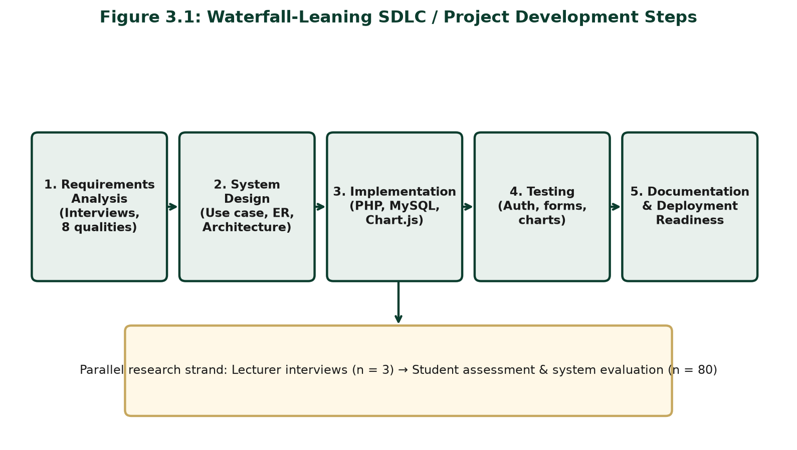
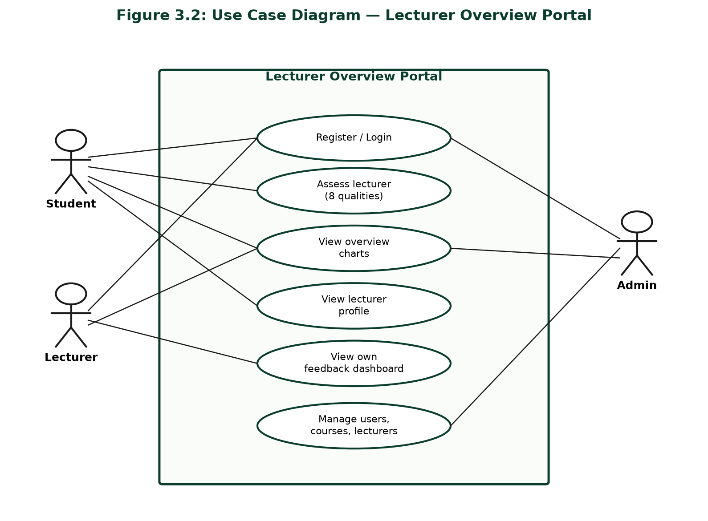
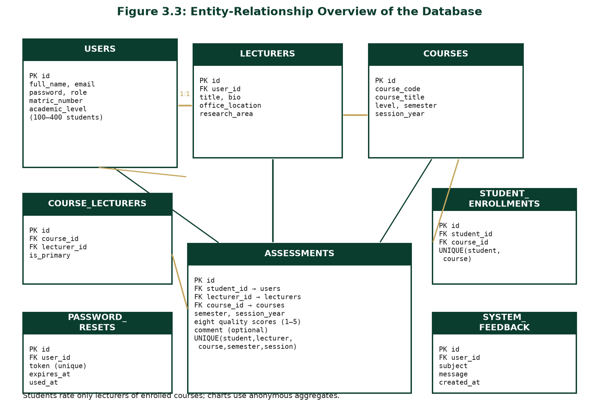
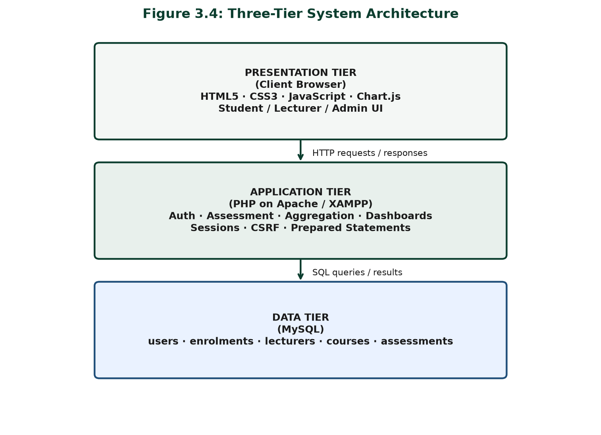
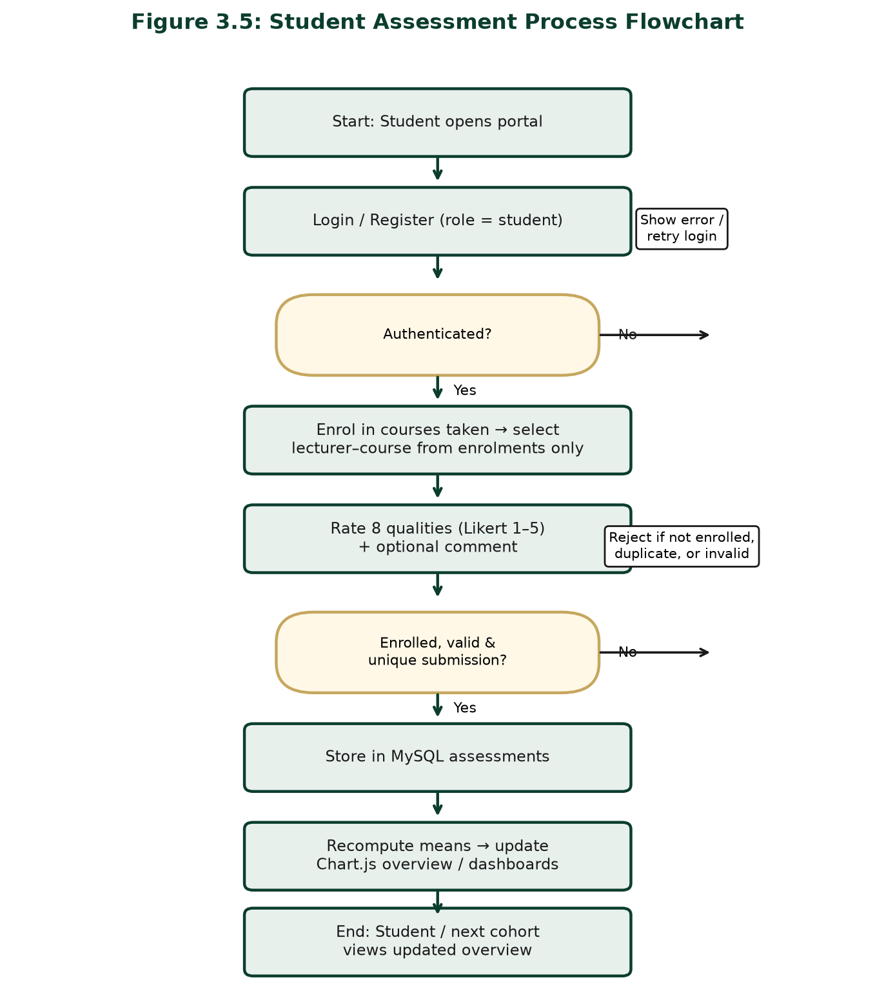
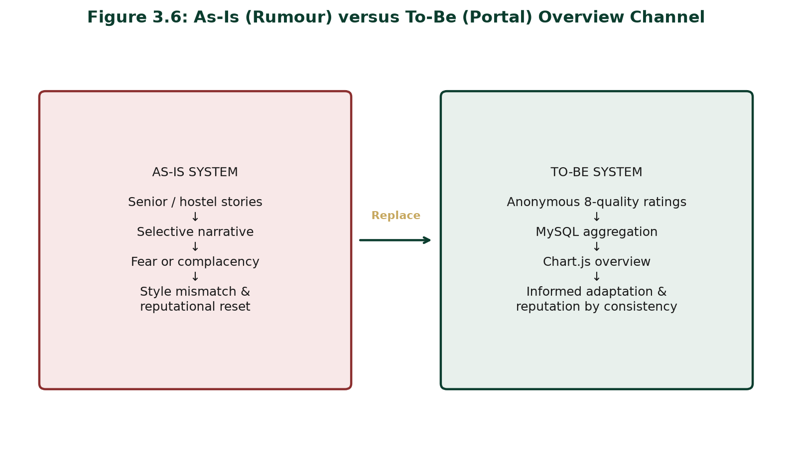

# CHAPTER THREE  
## RESEARCH METHODOLOGY AND SYSTEM ANALYSIS

### 3.1 Research Design / Adopted Methodology

This study adopted a mixed developmental research design. The survey/descriptive strand ascertained lecturer assessment qualities and evaluated portal usefulness. The developmental strand followed a waterfall-leaning System Development Life Cycle (SDLC)—requirements analysis, design, implementation, testing, and documentation—to build an online students’ system for preknowledge and overview of lecturers in the Department of Computer Science, University of Nigeria, Nsukka (Pressman & Maxim, 2015).

The work is applied design-and-implementation research. Stakeholder requirements were elicited through a fifteen-quality assessment questionnaire administered to ten lecturers and student sampling; an automated assessment instrument was specified on the eight qualities most frequently selected across the ten questionnaires; and a PHP/MySQL/Chart.js portal was engineered under XAMPP. Object-oriented analysis informed actors and use cases, while implementation used modular PHP scripts. Limited interface refinement during testing did not abandon stage discipline.

**Figure 3.1: Waterfall-Leaning SDLC / Project Development Steps**

### 3.2 Population of the Study

The population comprised: (1) Computer Science lecturers teaching undergraduate courses at UNN, who supplied assessment-quality ideas through a fifteen-quality questionnaire; and (2) undergraduate Computer Science students (100–400 levels), who rated lecturers and evaluated the portal. Lecturers anchored Objective One (eight qualities after screening fifteen down to the eight most selected). Students provided ratings and judged whether overview reduced reliance on informal rumour.

### 3.3 Sample Size and Sampling Technique

**Lecturers.** Purposive sampling selected ten (n = 10) active undergraduate teachers. Each lecturer completed a questionnaire listing fifteen assessment qualities. The eight qualities most frequently selected across the ten questionnaires were retained for the portal.  

**Students.** Stratified sampling by level balanced fresher and older voices among undergraduates associated with the courses taught by the interviewed lecturers. Sample size used Taro Yamane (1967):

n = N / [1 + N(e)²]

With accessible population N = 100 and e = 0.05:

n = 100 / [1 + 100(0.05)²] = 100 / [1 + 0.25] = 100 / 1.25 = 80

Thus the planned student sample size was 80. Realised fieldwork figures are reported in Chapter Four.

### 3.4 Instrumentation

1. **Lecturer Questionnaire (fifteen assessment qualities) — Objective 1** — Ten lecturers each completed a questionnaire listing fifteen assessment qualities, together with items on reputational misconception and acceptable feedback formats. The eight qualities most frequently selected across the ten questionnaires were retained as one eight-quality framework (Appendices).  
2. **Automated Student Assessment Form — Objective 2** — five-point Likert items on the eight compiled qualities plus optional comment.  
3. **System Evaluation Questionnaire** — clarity, anonymity, chart usefulness, and mobile usability after portal use.

**Table 3.1: System Development Tools and Technologies**

| Layer | Tools / Technologies |
|-------|----------------------|
| Frontend | HTML5, CSS3, JavaScript |
| Charts | Chart.js |
| Backend | PHP (mysqli, with PDO fallback for portability) |
| Database | MySQL |
| Local server stack | Apache under XAMPP |
| Security controls | password_hash/password_verify; sessions regenerated on login; prepared statements; CSRF tokens (cookie + form); rate limiting (5 attempts / 15-min lockout on login, register, forgot-password); single-use, 1-hour password-reset tokens; secure/HttpOnly/SameSite cookies; generic errors (no email enumeration); role-based access |

**Table 3.2: Major System Modules**

| Module | Primary users | Function |
|--------|---------------|----------|
| Authentication | All roles | Registration, login, logout; role-based access |
| Student profile / level | Students | Set and update current academic level (100–400) |
| Course enrolment | Students, admin | Student selects compulsory/elective courses offered for the semester |
| Assessment form | Students | End-of-semester rating of lecturers for selected courses only |
| Overview / charts | Students, lecturers | Aggregated bar and radar views |
| Lecturer profile | Students, lecturers | Dimensional teaching summary |
| Administration | Admin | Manage users, courses, lecturers, and enrolments |
| Password recovery | All roles | Request a reset link by email; set a new password via a single-use, time-limited token |
| System feedback | All authenticated users | Optional subject/message feedback about the portal (moderated by admin) |

### 3.5 Validity and Reliability of Instrument

Face and content validity of the compiled eight-quality items, assessment form, and evaluation questionnaire were established through review by the supervisor, Dr. E. C. Ukekwe, and cross-checking against the questionnaire responses. Items mapped one-to-one to the eight qualities synthesised from the responses of the ten lecturers. Pilot testing refined wording (especially audibility versus communication). Cronbach’s Alpha ≥ 0.70 was accepted as adequate internal consistency for the multi-item student instruments.

### 3.6 Method of Data Collection

Phase One: administer the fifteen-quality assessment questionnaire to ten lecturers, collate their selections, and retain the eight qualities most frequently selected across the ten questionnaires. Phase Two: build the portal from those requirements. Phase Three: students complete anonymous assessments. Phase Four: users complete the system evaluation questionnaire after viewing charts. Consent, voluntary participation, and anonymity of public aggregates were observed.

### 3.7 Method of Data Analysis

Questionnaire responses from the ten lecturers were collated and the selection frequency of each of the fifteen listed qualities was counted. The eight qualities most frequently selected across the ten questionnaires were retained and fixed for the automated form. Quantitative student responses used frequencies, percentages, and means (1.00–2.49 Low; 2.50–3.49 Moderate; 3.50–5.00 High). Chapter Four hypothesis tests use Chi-square and ANOVA/mean-profile comparison at α = 0.05. Portal aggregates support the chart evidence.

#### 3.7.1 Computation of Total Overview (Overall Lecturer Rating)
The Total Overview, or overall lecturer rating, is computed from student ratings in three steps.

Step 1 - Mean score per quality. For each of the eight qualities (interactiveness, audibility, lecture notes, class control, communication, punctuality, fairness, approachability), compute the mean of all student ratings given to that lecturer on that quality, using the 1-5 Likert scale:

    Quality Mean = (sum of student ratings on the quality) / (number of raters)

Each quality mean is rounded to two decimal places.

Step 2 - Total Overview (overall rating). The overall lecturer rating is the simple average of the eight quality means:

    Overall Rating = (sum of the eight quality means) / 8

The result is rounded to two decimal places.

Step 3 - Interpretation band. The overall rating is interpreted using the study's agreed bands: 1.00-2.49 = Low; 2.50-3.49 = Moderate; 3.50-5.00 = High.

The portal implements this computation from aggregated, anonymous assessment records and displays quality profiles dimensionally rather than reducing a lecturer to a single rank, consistent with the multidimensional SET position reviewed in Chapter Two.

### 3.8 Ethical Considerations

Participation was informed and voluntary. Public charts show aggregates only. Results are formative for orientation and improvement, not sole promotion criteria (Ani, 2020). Software controls (password hashing, session regeneration, prepared statements, CSRF tokens, rate limiting, single-use password-reset tokens, secure cookies, role separation) protect data and privacy.

### 3.9 System Analysis

#### 3.9.1 Analysis of the Existing (As-Is) System

Existing lecturer overview is mainly informal—senior advice, hostel talk, and messaging groups. Administrative feedback, where present, is not a continuous student-facing dimensional chart tool. Stories stick across cohorts; confidentiality is weak; extreme anecdotes travel farther than multi-rater evidence. The failure mode is information asymmetry filled by high-reach, low-reliability narrative.

#### 3.9.2 The Proposed (To-Be) System

The proposed authenticated portal—delivering **Objective 3**—follows a clear semester cycle. At the **beginning of the semester**, the administrator publishes compulsory and elective course offerings for each academic level and assigns the lecturer(s) taking each course. Logged-in students then **select the courses they are offering** for that semester (filtered by their stored academic level). At the **end of the semester**, students rate only the lecturers of those selected courses on the eight qualities. The system stores ratings anonymously for public view, recalculates means in MySQL, and updates Chart.js overview dashboards for students, lecturers, and administrators—so the next cohort can use the charts as preknowledge. The portal competes with rumour using multi-item scales and updateable aggregates (see Figure 3.6).

**Table 3.3: Existing System versus Proposed System**

| Criterion | Existing (informal) | Proposed portal |
|-----------|---------------------|-----------------|
| Source of overview | Oral / senior rumour | Aggregated student ratings |
| Structure | Narrative, selective | Eight quality indicators |
| Updateability | Sticky; rarely revised | Recalculated from new submissions |
| Confidentiality | Weak / social exposure | Anonymous public aggregates |
| Speed of access | Uneven, person-dependent | On-demand dashboards |
| Visual summary | Absent | Chart.js bar and radar charts |
| Administrative use | Minimal / ad hoc | Role-based management modules |

#### 3.9.3 Justification of the Proposed System

The portal improves confidentiality, speed, updateability, and actionable preknowledge while protecting lecturers from single-story distortion through multi-rater aggregation.

### 3.10 System Design

#### 3.10.1 Use Case Design

Actors are Student, Lecturer, and Admin. Core use cases: register/login; request and complete password recovery; update academic level and profile; enrol in courses; assess a lecturer of an enrolled course; view overview charts; view lecturer profiles; submit system feedback; view personal feedback dashboard (lecturer); manage users/courses/lecturers/enrolments (admin).

**Figure 3.2: Use Case Diagram — Lecturer Overview Portal**

#### 3.10.2 Database / Entity-Relationship Design

Core entities: **users** (with academic_level, pending_level, and profile_picture for students), **lecturers**, **courses** (level, course_type compulsory/elective, semester, session), **course_lecturers**, **student_enrollments**, **assessments**, **portal_settings** (global toggles such as student access), **password_resets** (single-use, time-limited recovery tokens), and **system_feedback** (optional portal feedback). Admin publishes offerings and lecturer assignments; students select courses; assessment is limited to lecturers of selected courses and to one submission per student–lecturer. Schema: portal/sql/schema.sql.

**Figure 3.3: Entity-Relationship Overview of the Database**

#### 3.10.3 System Architecture

Three-tier design: browser (HTML/CSS/JS + Chart.js); PHP application on Apache/XAMPP; MySQL data store.

**Figure 3.4: Three-Tier System Architecture**

#### 3.10.4 SDLC Stages Adopted

Figure 3.1 summarises requirements, design, implementation, testing, and documentation/deployment readiness.

#### 3.10.5 Input and Output Design

**Inputs:** credentials; registration fields (including student matric number and academic level); optional profile picture upload (JPG/PNG/GIF/WEBP, max 2 MB); course enrolment selections; level-change requests submitted for admin approval; Likert ratings (1–5) for enrolled lecturer–course pairs; optional comment; password-recovery request (email) and new password; system-feedback subject and message; admin create/update forms and portal-access toggle. **Outputs:** messages, profiles (including pending-level status), bar/radar charts, dashboards, admin lists, password-reset confirmation, feedback acknowledgement. Aggregates are privileged over rater identity; interfaces support mobile use. Academic level does not advance automatically—students request a change and it takes effect only after admin approval.

#### 3.10.6 Process / Control Flow

Authenticate → (start of semester) select courses offered from admin-published compulsory/elective list for the student’s level → (end of semester) select lecturer–course from those selections only → submit eight-quality form → validate session/CSRF/enrolment and one-assessment-per-student–lecturer rule → store if unique → recompute means → render charts for overview (preknowledge for subsequent students).

**Figure 3.5: Student Assessment Process Flowchart**

#### 3.10.7 Security Design

Passwords use password_hash/password_verify; pages require role sessions (regenerated on login); SQL uses prepared statements; forms use CSRF tokens (cookie + hidden field); login/register/forgot-password are rate-limited (5 attempts, 15-minute lockout); password recovery uses single-use, 1-hour tokens; cookies are secure/HttpOnly/SameSite=Lax; generic errors prevent email enumeration; public views expose aggregates only.

**Figure 3.6: As-Is (Rumour) versus To-Be (Portal) Overview Channel**

### 3.11 Summary of Methodology

The chapter combined lecturer questionnaires listing fifteen qualities administered to ten lecturers, from which the eight most selected were retained, stratified student sampling (Yamane n = 80), validated instruments, and waterfall-leaning SDLC development on PHP, MySQL, Chart.js, and XAMPP. As-is analysis showed rumour-dominated overview; the to-be portal provides anonymous, chart-driven preknowledge on eight teaching qualities, preparing Chapter Four’s implementation and evaluation.
